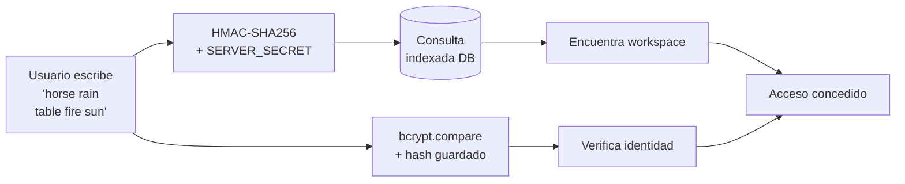

<div align="center">


# POLLO

### La app de listas que no sabe quién eres.

**Sin cuentas. Sin email. Sin contraseña. Solo cinco palabras.**

<br/>

[](https://nextjs.org)
[](https://www.typescriptlang.org)
[](https://supabase.com)
[](https://tailwindcss.com)
[](https://vercel.com)
[](https://web.dev/progressive-web-apps/)
[](LICENSE)

<br/>

[Read this in English](README.md) · [Demo en vivo](https://pollolist.app) · [Reportar bug](https://github.com/patatapython/pollo/issues)

</div>

---

## Capturas de pantalla

<div align="center">

<table>
  <tr>
    <td align="center" width="25%">
      <br/>
      <sub><b>Sin cuenta</b><br/>Abre la app, recibe cinco palabras, entra.</sub>
    </td>
    <td align="center" width="25%">
      <br/>
      <sub><b>Tu passphrase</b><br/>Cinco palabras. La única llave a tu espacio.</sub>
    </td>
    <td align="center" width="25%">
      <br/>
      <sub><b>Tus listas</b><br/>Todas en un lugar, compartidas en tiempo real.</sub>
    </td>
    <td align="center" width="25%">
      <br/>
      <sub><b>Tacha lo que hagas</b><br/>Funciona offline y sincroniza al volver.</sub>
    </td>
  </tr>
</table>

</div>

---

## La idea

La mayoría de apps te hacen crear una cuenta antes de que puedas hacer algo útil. Te piden el email, que lo verifiques, que elijas contraseña, que aceptes la política de privacidad — y para entonces ya has olvidado lo que querías apuntar.

Pollo funciona diferente.

Recibes **cinco palabras aleatorias**. Esa es tu cuenta. Esa es tu contraseña. Eso es lo que compartes. Sin registro. Sin datos sobre ti. Abre la app, escribe tu lista, ciérrala. Vuelve mañana con tus cinco palabras y todo sigue ahí.

```
horse · rain · table · fire · sun
```

Eso es todo. Ese es tu espacio.

### Dos cosas igual de fáciles

**Usarlo tú:**
Introduce tus cinco palabras → estás dentro. Desde cualquier dispositivo, en cualquier momento.

**Compartirlo con alguien:**
Dales tus cinco palabras → entran al mismo espacio exacto. Las mismas listas. En tiempo real. Sin invitaciones, sin cuentas, sin permisos. Solo palabras.

Esto hace que Pollo sea genuinamente útil para parejas, compañeros de piso, familias o equipos pequeños que quieren listas compartidas sin la complejidad de una herramienta de colaboración.

---

## Cómo funciona el sistema de passphrase

Este es el núcleo técnico del proyecto.

### Generación

Las passphrases se generan desde un diccionario curado de **7.776 palabras en español** obtenido de [dadoware-bonito-es](https://github.com/mir123/dadoware-bonito-es) de [@mir123](https://github.com/mir123) — una lista de palabras Diceware en español basada en el estándar EFF. Se seleccionan cinco palabras con `crypto.getRandomValues()` y rejection sampling para eliminar el sesgo de módulo:

```typescript
function getSecureRandomIndex(max: number): number {
  const bytesNeeded = Math.ceil(Math.log2(max) / 8);
  const maxValid = Math.pow(256, bytesNeeded);
  const limit = maxValid - (maxValid % max);

  while (true) {
    const randomBytes = crypto.getRandomValues(new Uint8Array(bytesNeeded));
    let value = 0;
    for (let i = 0; i < bytesNeeded; i++) {
      value = (value << 8) | randomBytes[i];
    }
    if (value < limit) return value % max;
  }
}
```

**Entropía:** ~12,9 bits × 5 palabras = **~64,5 bits totales** — 7.776⁵ ≈ 28 billones de combinaciones. La fuerza bruta no es un ataque viable.

### Almacenamiento: dos hashes, un secreto, cero texto plano

La passphrase **nunca se almacena en texto plano**. Se guardan dos valores derivados:

| Campo | Algoritmo | Propósito |
|---|---|---|
| `passphrase_hash` | bcrypt (12 rondas) | Verificación — lento por diseño |
| `passphrase_lookup` | HMAC-SHA256 | Búsqueda O(1) indexada |

bcrypt es no determinista — no puedes hacer `WHERE hash = bcrypt(input)`, sería un escaneo completo. HMAC es determinista: misma entrada + mismo secreto = misma salida. El login es una sola consulta indexada.



`SERVER_SECRET` nunca toca la base de datos. Una DB filtrada da al atacante hashes bcrypt (caros de crackear) y digests HMAC (inútiles sin el secreto). **Dos capas, dos secretos, cero filtración útil.**

---

## Funcionalidades

| | |
|---|---|
| **Auth sin cuenta** | Passphrase de cinco palabras, generada criptográficamente |
| **Múltiples listas** | Listas e items ilimitados por workspace |
| **Sync en tiempo real** | Supabase Realtime vía WebSockets |
| **Soporte offline** | Funciona sin internet, sincroniza al reconectar |
| **Kit de recuperación** | Exporta la passphrase como archivo de texto o imagen |
| **Bilingüe** | Interfaz completa en español e inglés con selector de idioma |
| **Mobile-first** | UI responsive y táctil — instálala como PWA desde el navegador |
| **Rate limiting** | Protección por IP contra fuerza bruta |
| **Sin tracking** | Sin analytics, sin cookies más allá de la sesión |

---

## Stack tecnológico

[-000?style=for-the-badge&logo=nextdotjs)](https://nextjs.org)
[](https://www.typescriptlang.org)
[-3ECF8E?style=for-the-badge&logo=supabase&logoColor=white)](https://supabase.com)
[](https://tailwindcss.com)
[](https://zustand-demo.pmnd.rs)
[](https://vitest.dev)
[](https://vercel.com)

La capa de auth es completamente custom: **JWT** (`jose`) + **bcrypt** (`bcryptjs`) + **HMAC-SHA256** (Web Crypto API). Sin dependencias de librerías de auth.

---

## Seguridad

| Riesgo | Solución |
|---|---|
| Almacenamiento de passphrase | bcrypt factor 12 — lento intencionalmente |
| Búsqueda de passphrase | HMAC-SHA256 con secreto server-side |
| Sesión | JWT HS256, cookie httpOnly, expiración 24h |
| XSS | Cookies httpOnly — JS no puede leer el token |
| CSRF | SameSite=lax |
| Clickjacking | `X-Frame-Options: DENY` |
| Fuerza bruta | Rate limiting por IP |
| Transporte | HSTS max-age 2 años |
| Secretos | Validados al arrancar — la app no bootea si faltan |

---

## Esquema de base de datos

<details>
<summary>Ver esquema</summary>

```sql
workspaces
  id                UUID PRIMARY KEY
  passphrase_hash   TEXT          -- bcrypt(passphrase, 12 rondas)
  passphrase_lookup TEXT UNIQUE   -- HMAC-SHA256(passphrase, SERVER_SECRET)
  created_at        TIMESTAMPTZ

lists
  id                UUID PRIMARY KEY
  workspace_id      UUID → workspaces
  name              VARCHAR(255)
  position          INT

items
  id                UUID PRIMARY KEY
  list_id           UUID → lists
  name              VARCHAR(500)
  is_completed      BOOLEAN
  completed_at      TIMESTAMPTZ   -- auto-set por trigger
  position          INT

rate_limit_attempts
  ip_address        INET
  success           BOOLEAN
  attempted_at      TIMESTAMPTZ   -- limpieza automática a las 24h
```

Índices en cada FK y campo de búsqueda. `passphrase_lookup` tiene índice único — el login es siempre una sola consulta indexada.

</details>

---

## Ejecución local

**Requisitos:** Node.js 18+, proyecto de [Supabase](https://supabase.com).

```bash
git clone https://github.com/patatapython/pollo.git
cd pollo
npm install
cp .env.example .env.local   # rellena tus valores
npm run dev
```

Migraciones: Supabase → SQL Editor → ejecutar archivos en `supabase/migrations/` en orden.

<details>
<summary>Variables de entorno</summary>

```env
# Requeridas
NEXT_PUBLIC_SUPABASE_URL=https://xxxx.supabase.co
NEXT_PUBLIC_SUPABASE_ANON_KEY=eyJ...
SUPABASE_SERVICE_ROLE_KEY=eyJ...
JWT_SECRET=cadena-aleatoria-minimo-32-chars
SERVER_SECRET=cadena-aleatoria-minimo-32-chars

# Opcionales
NEXT_PUBLIC_APP_URL=http://localhost:3000

```

Genera secretos: `openssl rand -base64 48`

</details>

---

## Decisiones de arquitectura

<details>
<summary>¿Por qué sin cuentas de usuario?</summary>

Cuentas de usuario implican emails, lo que implica una base de datos que vale la pena atacar. Workspaces con passphrase significan: cero PII almacenado, nada útil que filtrar, cero fricción en el primer uso.

El tradeoff es deliberado: pierdes tus cinco palabras, pierdes tu workspace. No hay "olvidé mi contraseña" porque no hay email. Feature, not bug.

</details>

<details>
<summary>¿Por qué HMAC para lookup en vez de bcrypt?</summary>

bcrypt es no determinista — dos hashes del mismo input dan valores distintos. `WHERE hash = bcrypt(input)` es imposible. Necesitarías un escaneo completo de la tabla.

HMAC-SHA256 es determinista. Se computa en el login, se consulta `WHERE lookup = hmac(input, secret)` sobre una columna indexada. Una sola consulta, tiempo constante, escala indefinidamente.

El secreto HMAC nunca toca la base de datos. Acceso completo a la DB + sin secreto del servidor = cero passphrases recuperadas.

</details>

<details>
<summary>¿Por qué Zustand en vez de Redux?</summary>

El estado es pequeño y viene del servidor. La API minimalista de Zustand — sin boilerplate, sin providers, sin split de actions/reducers — encaja con la filosofía del proyecto: lo mínimo necesario, bien hecho.

</details>

---

## Tests

```bash
npm test          # Ejecutar todos los tests
npm run test:ui   # Vitest UI en el navegador
```

Cubre: crypto de passphrases, ciclo de sesiones, validación de APIs, validación de env al arrancar.

---

## Contribuir

Proyecto de portfolio, pero issues y PRs son bienvenidos. Para problemas de seguridad, usa un issue privado.

---

## Licencia

MIT — ver [LICENSE](LICENSE).

---

<div align="center">

<sub>Construido con la convicción de que el software no necesita saber quién eres para ser útil.</sub>

</div>
