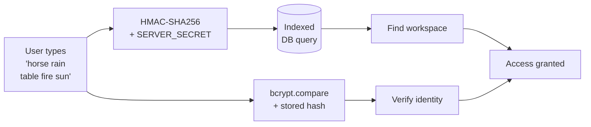

<div align="center">


# POLLO

### The list app that doesn't know who you are.

**No accounts. No email. No password. Just five words.**

<br/>

[](https://nextjs.org)
[](https://www.typescriptlang.org)
[](https://supabase.com)
[](https://tailwindcss.com)
[](https://vercel.com)
[](https://web.dev/progressive-web-apps/)
[](LICENSE)

<br/>

[Lee esto en Español](README.es.md) · [Live Demo](https://pollolist.app) · [Report Bug](https://github.com/patatapython/pollo/issues)

</div>

---

## Screenshots

<div align="center">

<table>
  <tr>
    <td align="center" width="25%">
      <br/>
      <sub><b>No account needed</b><br/>Open the app, get five words, you're in.</sub>
    </td>
    <td align="center" width="25%">
      <br/>
      <sub><b>Your passphrase</b><br/>Five words. The only key to your space.</sub>
    </td>
    <td align="center" width="25%">
      <br/>
      <sub><b>Your lists</b><br/>All in one place, shared in real time.</sub>
    </td>
    <td align="center" width="25%">
      <br/>
      <sub><b>Check things off</b><br/>Works offline, syncs when back online.</sub>
    </td>
  </tr>
</table>

</div>

---

## The idea

Most apps make you create an account before you can do anything useful. They ask for your email, make you verify it, pick a password, accept their privacy policy — and by then you've forgotten what you wanted to write down.

Pollo works differently.

You get **five random words**. That's your account. That's your password. That's your shared space. No registration. No data about you. Open the app, write your list, close it. Come back tomorrow with your five words and everything is there.

```
horse · rain · table · fire · sun
```

That's it. That's your workspace.

### Two things that are equally easy

**Using it yourself:**
Enter your five words → you're in. Every device, every time.

**Sharing with someone:**
Give them your five words → they're in the exact same space. Same lists. Real time. No invites, no accounts, no permissions. Just words.

This makes Pollo genuinely useful for couples, roommates, families, or small teams who want shared lists without the overhead of collaboration software.

---

## How the passphrase system works

This is the technical heart of the project.

### Generation

Passphrases are generated from a curated dictionary of **7,776 Spanish words** sourced from [dadoware-bonito-es](https://github.com/mir123/dadoware-bonito-es) by [@mir123](https://github.com/mir123) — a Spanish Diceware wordlist based on the EFF standard. Five words are selected using `crypto.getRandomValues()` with rejection sampling to eliminate modulo bias:

```typescript
function getSecureRandomIndex(max: number): number {
  const bytesNeeded = Math.ceil(Math.log2(max) / 8);
  const maxValid = Math.pow(256, bytesNeeded);
  const limit = maxValid - (maxValid % max);

  while (true) {
    const randomBytes = crypto.getRandomValues(new Uint8Array(bytesNeeded));
    let value = 0;
    for (let i = 0; i < bytesNeeded; i++) {
      value = (value << 8) | randomBytes[i];
    }
    if (value < limit) return value % max;
  }
}
```

**Entropy:** ~12.9 bits per word × 5 words = **~64.5 bits total** — 7,776⁵ ≈ 28 trillion combinations. Brute force is not a realistic attack.

### Storage: two hashes, one secret, zero plaintext

The passphrase is **never stored in plaintext**. Two derived values are computed and stored:

| Field | Algorithm | Purpose |
|---|---|---|
| `passphrase_hash` | bcrypt (12 rounds) | Verification — slow by design |
| `passphrase_lookup` | HMAC-SHA256 | O(1) indexed database lookup |

The lookup hash is the key design insight. bcrypt is non-deterministic — you can't `WHERE hash = bcrypt(input)`. That would be a full table scan. HMAC is deterministic: same input + same secret = same output, always. So login is a single indexed query.



`SERVER_SECRET` never touches the database. A leaked database gives an attacker bcrypt hashes (expensive to crack) and HMAC digests (useless without the server secret). **Two layers, two secrets, zero useful leakage.**

---

## Features

| | |
|---|---|
| **No-account auth** | Five-word passphrase, cryptographically generated |
| **Multiple lists** | Unlimited lists and items per workspace |
| **Real-time sync** | Supabase Realtime via WebSockets |
| **Offline support** | Works without internet, syncs on reconnect |
| **Recovery kit** | Export passphrase as text file or image |
| **Bilingual** | Full Spanish / English interface with language toggle |
| **Mobile-first** | Fully responsive, touch-friendly — install as PWA from your browser |
| **Rate limiting** | IP-based brute force protection |
| **No tracking** | No analytics, no cookies beyond the session |

---

## Tech stack

[-000?style=for-the-badge&logo=nextdotjs)](https://nextjs.org)
[](https://www.typescriptlang.org)
[-3ECF8E?style=for-the-badge&logo=supabase&logoColor=white)](https://supabase.com)
[](https://tailwindcss.com)
[](https://zustand-demo.pmnd.rs)
[](https://vitest.dev)
[](https://vercel.com)

Auth layer is fully custom: **JWT** (`jose`) + **bcrypt** (`bcryptjs`) + **HMAC-SHA256** (Web Crypto API). No auth library dependencies.

---

## Security

| Concern | Solution |
|---|---|
| Passphrase storage | bcrypt cost factor 12 — intentionally slow |
| Passphrase lookup | HMAC-SHA256 with server-side secret |
| Session | JWT HS256, httpOnly cookie, 24h expiry |
| XSS | httpOnly cookies — JS can't read the session token |
| CSRF | SameSite=lax |
| Clickjacking | `X-Frame-Options: DENY` |
| Brute force | IP-based rate limiting |
| Transport | HSTS 2-year max-age |
| Secrets | Validated at startup — app refuses to boot if missing |

---

## Database schema

<details>
<summary>Show schema</summary>

```sql
workspaces
  id                UUID PRIMARY KEY
  passphrase_hash   TEXT          -- bcrypt(passphrase, 12 rounds)
  passphrase_lookup TEXT UNIQUE   -- HMAC-SHA256(passphrase, SERVER_SECRET)
  created_at        TIMESTAMPTZ

lists
  id                UUID PRIMARY KEY
  workspace_id      UUID → workspaces
  name              VARCHAR(255)
  position          INT

items
  id                UUID PRIMARY KEY
  list_id           UUID → lists
  name              VARCHAR(500)
  is_completed      BOOLEAN
  completed_at      TIMESTAMPTZ   -- auto-set by trigger
  position          INT

rate_limit_attempts
  ip_address        INET
  success           BOOLEAN
  attempted_at      TIMESTAMPTZ   -- auto-cleaned after 24h
```

Indexes on every FK and lookup field. `passphrase_lookup` has a unique index — login is always a single indexed query.

</details>

---

## Running locally

**Prerequisites:** Node.js 18+, a [Supabase](https://supabase.com) project.

```bash
git clone https://github.com/patatapython/pollo.git
cd pollo
npm install
cp .env.example .env.local   # fill in your values
npm run dev
```

Run migrations: Supabase → SQL Editor → run files in `supabase/migrations/` in order.

<details>
<summary>Environment variables</summary>

```env
# Required
NEXT_PUBLIC_SUPABASE_URL=https://xxxx.supabase.co
NEXT_PUBLIC_SUPABASE_ANON_KEY=eyJ...
SUPABASE_SERVICE_ROLE_KEY=eyJ...
JWT_SECRET=minimum-32-character-random-string
SERVER_SECRET=minimum-32-character-random-string

# Optional
NEXT_PUBLIC_APP_URL=http://localhost:3000

```

Generate secrets: `openssl rand -base64 48`

</details>

---

## Architecture decisions

<details>
<summary>Why no user accounts?</summary>

User accounts mean email addresses, which means a database worth attacking. Passphrase workspaces mean: no PII stored, nothing useful to leak, zero friction on first use.

The tradeoff is deliberate: lose your five words, lose your workspace. No "forgot password" because there's no email. Feature, not bug.

</details>

<details>
<summary>Why HMAC for lookup instead of bcrypt?</summary>

bcrypt is non-deterministic — two hashes of the same input are different values. `WHERE hash = bcrypt(input)` is impossible. You'd need a full table scan.

HMAC-SHA256 is deterministic. Compute it at login time, query `WHERE lookup = hmac(input, secret)` on an indexed column. Single query, constant time, scales indefinitely.

The HMAC secret never touches the database. Full DB access + no server secret = no passphrases recovered.

</details>

<details>
<summary>Why Zustand instead of Redux?</summary>

State is small and server-fetched. Zustand's minimal API — no boilerplate, no providers, no actions/reducers split — matches the project's philosophy: minimum necessary, done well.

</details>

---

## Tests

```bash
npm test          # Run all tests
npm run test:ui   # Vitest browser UI
```

Covers: passphrase crypto, session lifecycle, API validation, env startup checks.

---

## Contributing

Portfolio project, but issues and PRs are welcome. For security issues, use a private issue.

---

## License

MIT — see [LICENSE](LICENSE).

---

<div align="center">

<sub>Built with the belief that software doesn't need to know who you are to be useful.</sub>

</div>
